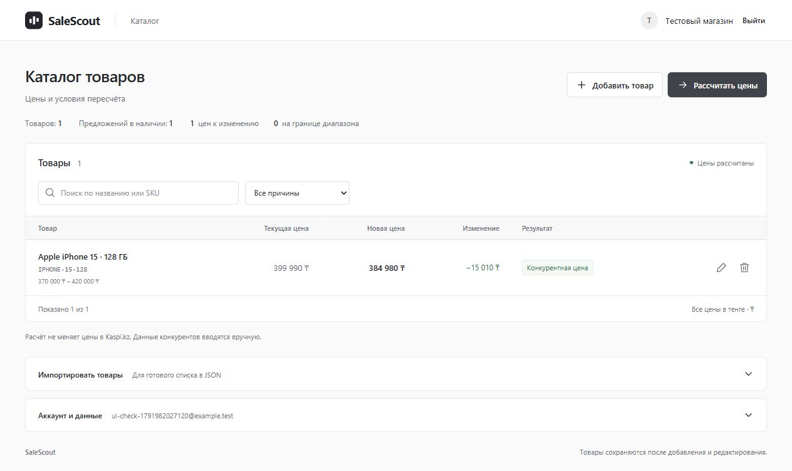
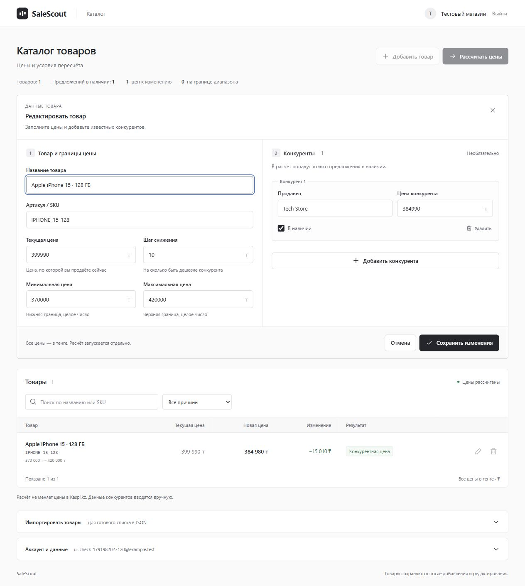
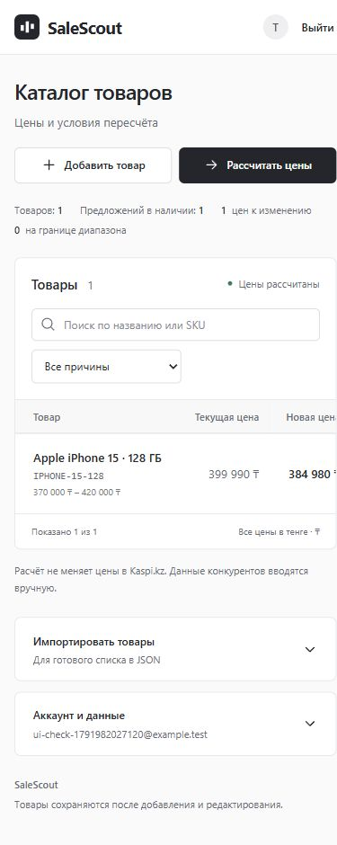

# SaleScout

Веб-приложение для расчёта цен продавца на Kaspi.kz. Добавьте товар, укажите цены конкурентов и допустимый диапазон — SaleScout рассчитает новую цену и объяснит результат. Товары сохраняются в личном кабинете и доступны после входа с другого устройства.

**React · TypeScript · Express · PostgreSQL · Docker**

Проект вырос из тестового задания по веб-разработке. В нём реализованы расчёт цен, API, интерфейс и аккаунты пользователей. Цены конкурентов вводятся вручную; автоматического сбора данных и отправки цен в Kaspi.kz в этой версии нет.



[Быстрый старт](#быстрый-старт) · [Первый расчёт](#первый-расчёт) · [Разработка](#разработка) · [Проверки](#проверки) · [Развёртывание](#публичное-развёртывание) · [API](docs/API.md)

## Возможности

- **Личный кабинет:** регистрация, подтверждение почты, вход, выход и восстановление пароля.
- **Свой каталог:** добавление и редактирование товаров, конкурентов, наличия, минимальной и максимальной цены.
- **Расчёт:** таблица текущей и новой цены, разница и причина ограничения цены.
- **Работа с данными:** поиск по названию и SKU, фильтр по причине, импорт и экспорт JSON.
- **Сохранение:** PostgreSQL и проверка версии каталога, чтобы одна вкладка не перезаписала изменения другой.
- **Google и Apple:** серверная интеграция и привязка из кабинета. Включаются после настройки собственных ключей провайдера.
- **Аккаунт и данные:** выгрузка товаров и удаление своего аккаунта с подтверждением пароля.
- **Адаптивный интерфейс:** формы для компьютера и телефона; широкая таблица прокручивается горизонтально.

## Быстрый старт

### 1. Подготовьте окружение

Понадобятся:

- **Node.js 24** и npm для локальных команд. Совместимость с Node.js 20 из исходного задания также проверяется в CI.
- **Docker с Compose v2**, запущенный в режиме Linux containers. На Windows подойдёт Docker Desktop.
- **Git**, если клонируете репозиторий. Можно также скачать ZIP через кнопку **Code → Download ZIP** и распаковать его.

### 2. Скачайте и запустите

```sh
git clone https://github.com/nekronusss/SaleScout.git
cd SaleScout
npm install
npm run setup
docker compose up -d --build
```

Все команды выполняются в папке с `package.json`. Первый запуск занимает больше времени: Docker скачивает образы и собирает приложение.

`npm run setup` создаёт локальный `.env` со случайными секретами. Если файл уже существует, команда сохраняет его без изменений. Миграции базы выполняются при запуске сервера.

| Что открыть | Адрес |
| --- | --- |
| SaleScout | [http://localhost:3001](http://localhost:3001) |
| Тестовая почта Mailpit | [http://localhost:8025](http://localhost:8025) |
| Проверка подключения к базе | [http://localhost:3001/readyz](http://localhost:3001/readyz) |

Mailpit принимает письма только внутри локального окружения. Письмо подтверждения нужно искать в Mailpit, даже если при регистрации вы указали настоящий адрес Gmail или другой почты.

### 3. Создайте аккаунт

1. Откройте SaleScout и выберите **«Зарегистрироваться»**.
2. Укажите имя, email, например `seller@example.test`, и пароль от 10 символов.
3. Откройте Mailpit, найдите письмо SaleScout и перейдите по ссылке подтверждения.
4. Подтвердите почту кнопкой на странице и войдите в аккаунт.

Готовых аккаунтов и общих паролей в репозитории нет. Для первого запуска достаточно входа по почте: ключи Google и Apple не обязательны.

## Первый расчёт

Нажмите **«Добавить товар»** и заполните пример:

| Поле | Значение |
| --- | --- |
| Название | Apple iPhone 15 |
| Артикул / SKU | IPHONE-15-128 |
| Текущая цена | 399990 |
| Минимальная цена | 370000 |
| Максимальная цена | 420000 |
| Шаг снижения | 10 |
| Продавец-конкурент | Tech Store |
| Цена конкурента | 384990 |
| В наличии | Да |

Сохраните товар и нажмите **«Рассчитать цены»**. Новая цена — **384980 ₸**, причина — **«Конкурентная цена»**.

Чтобы посмотреть сразу несколько сценариев, в пустом каталоге нажмите **«Или загрузить пример»**. Эти товары находятся в [data/products.json](data/products.json), ожидаемые результаты — в [data/expected.json](data/expected.json).

Допускаются десятичная запятая или точка и пробелы в суммах. Минимальная и максимальная цена должны быть целыми. Предложения без отметки «В наличии» не участвуют в расчёте. Изменение товара сбрасывает предыдущий результат — после сохранения запустите расчёт снова.

<details>
<summary>Посмотреть форму товара и мобильную версию</summary>





</details>

## Остановка и повторный запуск

```sh
# Остановить контейнеры, сохранив базу
docker compose down

# Запустить снова
docker compose up -d

# Посмотреть состояние и логи
docker compose ps
docker compose logs --tail=100 app
```

Пользователи и товары сохраняются в Docker volume. Команда `docker compose down -v` удаляет этот том вместе с базой; для обычной остановки флаг `-v` не нужен.

## Разработка

Для изменения кода запускайте Vite и API на компьютере, а PostgreSQL и Mailpit — в Docker:

```sh
npm install
npm run setup
docker compose stop app
npm run infra
npm run dev
```

Откройте [http://localhost:5173](http://localhost:5173). Vite обновляет страницу при изменении React/CSS и проксирует `/api` и `/reprice` на сервер в порту 3001. `tsx watch` перезапускает API при изменении серверного кода.

В `.env` для этого режима должно быть `APP_ORIGIN=http://localhost:5173`. Полный Docker-стек сам задаёт приложению свой адрес. Не запускайте одновременно контейнер `app` и локальный API на одном порту.

| Команда | Назначение |
| --- | --- |
| `npm run dev` | Сервер и Vite вместе |
| `npm run dev:server` | Только сервер |
| `npm run dev:client` | Только Vite |
| `npm run typecheck` | Проверка типов TypeScript |
| `npm run build` | Проверка типов и сборка фронтенда/сервера в `dist/` |
| `npm start` | Запуск собранного приложения |
| `npm run backup` | Резервная копия локальной Docker-базы в `backups/` |

Для `npm start` сначала выполните сборку, запустите базу и почту и задайте `APP_ORIGIN=http://localhost:3001`. Сервер будет отдавать и интерфейс, и API. `npm ci` вместо `npm install` устанавливает точные версии из lockfile.

## Проверки

```sh
npm test
npm run infra
npm run test:integration
npm run build
```

- **`npm test`** — расчёт цены, HTTP-контракт, формы React, обработка ошибок, пароли, конфигурация и проверка OIDC-токенов. PostgreSQL не требуется.
- **`npm run test:integration`** — настоящая PostgreSQL: сессии, изоляция каталогов, конкурентное сохранение, почтовые токены и OAuth callback. Тесты создают и удаляют отдельную схему. Можно задать `TEST_DATABASE_URL`; нужен пользователь БД с правом создавать схемы.
- **`npm run test:smoke -- --restart`** — сквозная проверка запущенного полного Docker-стека: регистрация, письма Mailpit, сохранение каталога, расчёт, перезапуск приложения, сброс пароля и удаление тестового аккаунта. Команда перезапускает контейнер `app`; запускайте её в локальном тестовом окружении.

[GitHub Actions](.github/workflows/ci.yml) запускает unit/UI/API-тесты, интеграционные тесты с PostgreSQL и сборку на Node.js 20 и 24. Проверка OAuth в тестах использует тестовые ключи и ответы провайдеров; реальный вход проверяется отдельно после подключения Google/Apple.

## Как считается цена

Чистая функция [`calculatePrice(product)`](src/pricing.ts) не выполняет I/O и не меняет входной товар:

1. Берёт минимальную цену среди конкурентов с `inStock: true`.
2. Вычитает `step` и округляет вниз: `Math.floor(best - step)`.
3. Ограничивает результат диапазоном `minPrice…maxPrice`.
4. Если конкурентов в наличии нет, возвращает `maxPrice`.

| Причина API | Когда возвращается |
| --- | --- |
| `UNDERCUT` | Кандидат внутри диапазона, включая равенство границам |
| `AT_MIN` | Кандидат строго ниже минимальной цены |
| `AT_MAX` | Кандидат строго выше максимальной цены |
| `NO_COMPETITORS` | Нет конкурентов в наличии |

`myPrice` возвращается как `oldPrice` и не влияет на расчёт. Сложность — O(n) по количеству конкурентов и O(1) дополнительной памяти.

Исходный контракт тестового задания сохранён: именованный экспорт в `src/pricing.ts`, TypeScript-типы в [src/types.ts](src/types.ts), `POST /reprice` принимает `Product[]` и возвращает `PriceResult[]`. Эндпоинт доступен без аккаунта и не сохраняет данные. [Примеры запросов и API кабинета →](docs/API.md)

## Google и Apple

Реализованы серверный вход и привязка провайдера к существующему аккаунту. **Ключи не включены в репозиторий**, поэтому при первом запуске кнопки отключены.

После заполнения соответствующих переменных `.env` и перезапуска сервера провайдер станет доступен. Для Google можно настроить локальный callback; Apple требует публичного HTTPS-домена и настройки Apple Developer. Пошаговая инструкция: [docs/OAUTH.md](docs/OAUTH.md).

## Публичное развёртывание

Локальный `compose.yaml` использует тестовую почту и порты, доступные только с вашего компьютера. Для публичного сайта подготовлен отдельный `compose.prod.yaml`: PostgreSQL, приложение и Caddy для HTTPS.

Понадобятся сервер с Docker, домен, направленный на сервер, и реальный SMTP для писем пользователям. Заполните `.env` по [примеру](.env.example), включая `DOMAIN`, SMTP-параметры и уникальные секреты, затем выполните:

```sh
docker compose -f compose.prod.yaml up -d --build
```

Инструкция по HTTPS, резервным копиям, восстановлению и обновлениям: [DEPLOYMENT.md](DEPLOYMENT.md). Перед приглашением пользователей проверьте доставку писем, вход и восстановление резервной копии в своём окружении.

Текущая архитектура рассчитана на **один экземпляр приложения**. Лимиты запросов хранятся в памяти; для нескольких экземпляров нужен общий rate-limit store. Биллинг, командные роли, сбор цен Kaspi и автоматическая переоценка на площадке не реализованы. Контакты поддержки и документы об обработке данных задаёт владелец публичного сервиса.

## Структура проекта

```text
client/src/          React: вход, каталог, формы и стили
src/pricing.ts       Чистая функция расчёта цены
src/types.ts         Product, Competitor, PriceResult
src/validation.ts    Общая проверка структуры товара
server/app.ts        Express, /reprice, middleware и health checks
server/saas.ts       Аккаунты, сессии, почта и приватный каталог
server/oauth.ts      Google/Apple и проверка идентичности
server/db.ts         PostgreSQL и миграции
server/config.ts     Проверка переменных окружения
data/               Демонстрационные товары и ожидаемые результаты
tests/              Unit, HTTP, UI и PostgreSQL-интеграция
scripts/            Подготовка .env, backup и smoke-проверка
docs/               API, OAuth и скриншоты
```

Один аккаунт может сохранить до 500 товаров и до 100 конкурентов на товар; размер запроса ограничен 1 МБ. Пароли хешируются через scrypt, сессии хранятся в PostgreSQL. `.env`, резервные копии, `node_modules/` и `dist/` исключены из Git.

Проект создан с использованием AI-инструментов. Расчёт и проверки доступа покрыты собственными тестами; код доступен для изучения и проверки.
